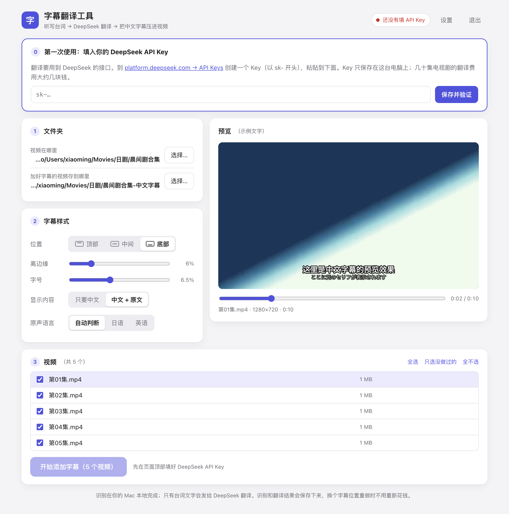

# Video Subtitle Translator · 字幕翻译工具

[简体中文](README.md) | **English** | [日本語](README.ja.md)

A small Mac app that **automatically adds Chinese subtitles** to foreign-language videos (Japanese, English, …).
Double-click to start, click a few buttons in your browser — **no programming needed**.

> **Please note:** the app's interface is in Chinese, and it translates **into Simplified Chinese only**.
> This page includes a [button-by-button translation of the interface](#interface-cheat-sheet) so you can use it without reading Chinese.



It does three things for you:

1. **Transcribe** — Whisper speech recognition turns the dialogue into timed text. It runs on your own Mac, for free; your video is never uploaded anywhere. (If the video already has text subtitles, those are used instead — faster and more accurate.)
2. **Translate** — DeepSeek first reads the whole episode (writes a plot summary, builds a list of character names, spots misheard words), then translates it into Simplified Chinese in batches.
3. **Burn in** — the subtitles are rendered into the picture at the position and size you chose, producing an MP4 that plays anywhere.

**Contents**

- [Before you start](#before-you-start)
- [Install](#install)
- [Get a DeepSeek API key](#get-a-deepseek-api-key)
- [First use](#first-use)
- [Interface cheat sheet](#interface-cheat-sheet)
- [Tips](#tips)
- [Speed and cost](#speed-and-cost)
- [Troubleshooting](#troubleshooting)
- [Privacy and API key safety](#privacy-and-api-key-safety)
- [Update and uninstall](#update-and-uninstall)
- [Files and advanced settings](#files-and-advanced-settings)
- [For developers](#for-developers)
- [Credits and license](#credits-and-license)

---

## Before you start

Make sure you have all of these:

| What you need | Details |
| --- | --- |
| **A Mac with Apple Silicon** | M1 / M2 / M3 / M4 … all work. Click the Apple menu (top-left corner) → “About This Mac”; the “Chip” line should say **Apple M…**.<br>Intel Macs and Windows PCs are **not supported**. |
| **macOS 14 or later** | Also shown in “About This Mac”. |
| **About 5 GB of free disk space** | 1 GB for the runtime + 1.6 GB for the speech model, plus the videos you produce. |
| **Internet access** | For installing, and for reaching DeepSeek when translating. |
| **A DeepSeek API key** | Used for translation. Pay-as-you-go and very cheap (a few dozen TV episodes cost a few Chinese yuan in total, around one US dollar). See [below](#get-a-deepseek-api-key); you can get it after installing. |

---

## Install

Three steps; all you do is paste one line. **No administrator password is needed**, everything goes into a single folder, and nothing else on your Mac is changed.

### Step 1: Open Terminal

Press `⌘ Space`, type `Terminal`, press Return. A window you can type into appears.

### Step 2: Paste this line and press Return

```bash
cd ~ && curl -fL https://github.com/bellingxu/video-subtitle-translator/archive/refs/heads/main.tar.gz | tar xz && bash video-subtitle-translator-main/install.sh
```

It will:

- download the tool into your home folder, in a folder named `video-subtitle-translator-main`;
- install the runtime (about 1 GB; usually 5–10 minutes depending on your connection).

Wait until you see **`✔ 安装完成！(Installation complete!)`**. Finder then opens with the launcher file selected.

> If the connection drops or something fails, just paste and run the same line again.

### Step 3: Double-click `字幕翻译工具.command`

A Terminal window opens (this is the app's “engine” — **keep it open while you work**) and the interface opens in your browser.

From now on, double-click that file whenever you want to use the tool. For convenience, right-click it → “Make Alias” and drag the alias to your Desktop.

<details>
<summary><b>Other ways to install</b> (ZIP download, git)</summary>

**ZIP download:** on the GitHub page click the green `Code` button → `Download ZIP`, unzip it, then double-click `字幕翻译工具.command` inside. On first launch it installs the runtime automatically.
With this method macOS blocks the file the first time (“cannot verify the developer”). See item 1 under [Troubleshooting](#troubleshooting).

**With git (easier to update later):**

```bash
git clone https://github.com/bellingxu/video-subtitle-translator.git
```

```bash
bash video-subtitle-translator/install.sh
```

</details>

---

## Get a DeepSeek API key

Think of an API key as a **key to your account**: the tool uses it to ask DeepSeek for translations, and the cost is charged to your DeepSeek balance.

1. Go to <https://platform.deepseek.com>, sign up and log in.
2. Find **Top up** in the left-hand menu and add a small amount (a couple of dollars lasts a long time). Translation fails if the balance is empty.
3. Find **API keys** in the left-hand menu and click **Create new API key**. Any name will do.
4. A string starting with `sk-` appears — that is your key. **Copy it right away**; it is shown only once.
5. Back in the tool, paste it and click **保存并验证** (Save and verify).

> ⚠️ **Your key is money. Never send it to anyone or post it online (screenshots included).**
> If it ever leaks, go back to the page in step 3, delete it and create a new one.

(Button names on DeepSeek's website may change slightly over time.)

---

## First use

1. **Double-click `字幕翻译工具.command`.** The interface opens in your browser.
2. **Enter your API key.** At the top of the page there is a “第一次使用” (first use) box. Paste the key and click “保存并验证”. When it works, the top-right corner shows “DeepSeek 已连接” (connected).
3. **Choose folders** (section 1, “文件夹”):
   - “视频在哪里” — the folder that holds your videos;
   - “加好字幕的视频存到哪里” — a different folder for the results (it cannot be the same one). You can create a new folder right in the chooser with “新建文件夹”.
   - If macOS asks whether “Terminal” may access a folder, click **Allow**.
4. **Adjust the subtitle style** (section 2, “字幕样式”): position, distance from the edge, font size, Chinese only or Chinese + original, and the spoken language. The preview on the right updates live; drag the slider under it to see another frame.
5. **Tick the videos to process** (section 3, “视频”) and click **开始添加字幕** (Start).
   - The **first time**, the speech model is downloaded (about 1.6 GB, once only). Please be patient.
   - Your Mac will not go to sleep while it works, and you get a notification when everything is done.
6. **Watch the result:** the output folder contains MP4 files with the subtitles burned in, named like the originals.
7. **When you are done:** click “退出” (Quit) in the top-right corner, or simply close the Terminal window.

---

## Interface cheat sheet

| On screen | Meaning |
| --- | --- |
| 设置 | Settings |
| 退出 | Quit |
| 保存并验证 | Save and verify (the API key) |
| 文件夹 | Folders |
| 视频在哪里 | Where your videos are |
| 加好字幕的视频存到哪里 | Where to save the subtitled videos |
| 选择… / 选择这个文件夹 | Choose… / Choose this folder |
| 新建文件夹 | New folder |
| 字幕样式 | Subtitle style |
| 位置：顶部 / 中间 / 底部 | Position: top / middle / bottom |
| 离边缘 | Distance from the edge |
| 字号 | Font size |
| 显示内容：只要中文 / 中文 + 原文 | Show: Chinese only / Chinese + original |
| 原声语言：自动判断 / 日语 / 英语 | Spoken language: auto-detect / Japanese / English |
| 预览 | Preview |
| 视频 | Videos |
| 全选 / 只选没做过的 / 全不选 | Select all / only unprocessed / none |
| 开始添加字幕 | Start adding subtitles |
| 取消 | Cancel |
| 剧情提示 | Story notes (title, character names, …) |
| 压制方式：省电安静 / 文件更小 | Encoding: cool and quiet / smaller files |
| 翻译模型 | Translation model |
| 完成 / 关闭 / 确定 | Done / Close / OK |

---

## Tips

- **Japanese TV programmes often have their own captions at the bottom of the picture.** Chinese subtitles placed at the bottom will overlap them. Switch the position to “顶部” (top) or increase “离边缘” (distance from the edge).
- **Changing the subtitle position costs nothing.** Transcripts and translations are stored in the tool's `data/cache/` folder. Tick a finished video and process it again: only the burn-in step is redone (tens of seconds per episode).
- **You can cancel or quit at any time.** Finished work is kept, and the tool picks up where it left off next time.
- **Settings → 剧情提示 (story notes):** write the show's title and the main characters' names, genders and relationships (in Chinese or in the original language). Translations get much better — for example, the heroine no longer becomes “he”. Notes are stored per video folder, so each show can have its own.
- **One show per folder, processed in order.** Videos in the same folder are treated as one series; the tool remembers how names were translated in earlier episodes and reuses them.
- **“中文 + 原文” (Chinese + original)** shows a smaller line of the original text under the Chinese — handy for language learners.
- **Settings → 压制方式 (encoding):**
  - “省电安静” (default) uses the Mac's hardware encoder: almost no CPU load, no heat, no fan noise; files are somewhat larger (about 225 MB for a 15-minute SD video).
  - “文件更小” uses software encoding: smallest files (about 160 MB), but the CPU runs flat out and the fans spin up.
- **Settings → 翻译模型 (translation model):** the default “flash” model is fast, cheap and good enough for everyday use; “pro” costs more and translates with more care.
- **If a video has an `.srt` file with the same name next to it, or embedded text subtitles,** the tool translates those instead of transcribing the audio — more accurate and faster. (Can be turned off in Settings.)
- **Separate subtitle files:** the `字幕文件/` folder inside the output folder holds `.srt` files for each episode (Chinese / original / bilingual), for review or for use in other players.
- **Subtitles will occasionally be wrong.** The dialogue is transcribed by a machine; where it mishears (especially mumbled short lines or background chatter), the translation is wrong too. This is normal.

---

## Speed and cost

Measured on an M1 Pro MacBook Pro with a 15-minute Japanese TV episode:

| Step | Time | Does it cost money? |
| --- | --- | --- |
| Transcribe (speech recognition) | about 75 s | No — runs on your Mac |
| Translate | about 12 s | A little — a few dozen episodes cost a few Chinese yuan in total |
| Burn in | about 35 s | No |

When several episodes are queued, the three steps run at the same time: about 1.5 minutes per episode on average.

---

## Troubleshooting

**1. Double-clicking the launcher shows “cannot be opened” or “cannot verify the developer”**

This only happens with the ZIP download (macOS is cautious about programs downloaded with a browser). Either:

- open “System Settings → Privacy & Security”, scroll down to the message about `字幕翻译工具.command` and click **Open Anyway**; or
- install with the one-line command under [Install](#install) instead, which does not trigger this.

**2. “没有权限查看这个文件夹” (no permission to view this folder) when choosing a folder**

Open “System Settings → Privacy & Security → Files and Folders”, find “Terminal” and switch on the folder in question (Documents, Downloads, Desktop, …).

**3. The first run stays on “下载语音识别模型” (downloading the speech model) for a long time**

The model is 1.6 GB, so a slow connection takes a while. This is normal.
In **mainland China**, Hugging Face (where the model is hosted) may be unreachable. Start the tool through a mirror instead (run in Terminal):

```bash
HF_ENDPOINT=https://hf-mirror.com ~/video-subtitle-translator-main/字幕翻译工具.command
```

Once the model has been downloaded, start the tool normally. (`hf-mirror.com` is a community-run mirror not affiliated with this project.)

**4. Installation is very slow or keeps failing**

First run the same install line again (downloads are retried). In mainland China you can use the Tsinghua University mirrors:

```bash
cd ~/video-subtitle-translator-main && CONDA_CHANNEL=https://mirrors.tuna.tsinghua.edu.cn/anaconda/cloud/conda-forge PIP_INDEX_URL=https://pypi.tuna.tsinghua.edu.cn/simple bash install.sh
```

**5. “API Key 无效” (invalid API key)**

Usually a few characters were lost when copying, or a space slipped in. Create a new key on DeepSeek's API keys page and paste it again (you can replace the key under “设置”).

**6. “余额不足” (insufficient balance)**

Top up at <https://platform.deepseek.com>, then click “开始添加字幕” again. Finished work is not redone.

**7. Names are translated inconsistently, or genders are mixed up**

Write the characters' names, genders and relationships under “设置 → 剧情提示”, then tick the videos and process them again (they are re-translated).

**8. Can it translate into languages other than Chinese?**

Not at the moment — **Simplified Chinese only**. The spoken language can be something other than Japanese or English; see [advanced settings](#files-and-advanced-settings).

**9. Which video formats are supported?**

All the common ones: `mp4` `mkv` `avi` `mov` `m4v` `wmv` `flv` `webm` `ts` `m2ts` `mts` `mpg` `mpeg` `rmvb` `rm` `3gp` `vob` `ogv` `asf` `divx` `f4v`. Output is always MP4.

**10. Can I close the Terminal window?**

Not while you are using the tool — that window *is* the tool. Close it when you are done (or click “退出” in the interface).

**11. I closed the browser tab by accident**

Double-click `字幕翻译工具.command` again. The interface reopens, and a running job is not affected.

Something else? Please open an [issue](https://github.com/bellingxu/video-subtitle-translator/issues). **Never include your API key in an issue or a screenshot.**

---

## Privacy and API key safety

- **Your video and audio never leave your Mac.** Speech recognition runs entirely on your machine.
- **Only text is sent to DeepSeek:** the dialogue, the video's file name, and the story notes you wrote.
- **Your API key is stored only on your own Mac,** in `data/secrets.json` inside the tool's folder, readable only by you. It is sent only to DeepSeek's official API, to prove the request is yours.
- **The interface can only be opened from your own Mac** (its address is `127.0.0.1`); other people on the same Wi-Fi cannot connect.
- **If you modify this project and push it to your own GitHub:** the `data/` folder (your key, settings and cache) is listed in `.gitignore`, so git will not commit it. But **do not upload the whole folder by drag-and-drop on the GitHub website** — web uploads are not protected by `.gitignore`.

---

## Update and uninstall

**Update:** run the line from step 2 of [Install](#install) again. Your settings, API key and finished translations are kept.

**Uninstall:** delete the `video-subtitle-translator-main` folder in your home folder.
The speech model lives elsewhere. To remove it too, press `⇧⌘G` in Finder, enter `~/.cache/huggingface/hub`, and delete `models--mlx-community--whisper-large-v3-turbo`.

---

## Files and advanced settings

| Path | What it is |
| --- | --- |
| `字幕翻译工具.command` | Double-click to start |
| `install.sh` | Installs the runtime (the launcher calls it automatically) |
| `subtitle_tool/` | The tool's code (`web/index.html` is the interface) |
| `requirements.txt` | The list of libraries used for speech recognition |
| `runtime/` | Exists after installing: the bundled runtime (Python 3.12 + ffmpeg + speech libraries, about 1 GB) |
| `data/settings.json` | Exists after first use: your options |
| `data/secrets.json` | Exists after first use: your DeepSeek API key (readable only by you) |
| `data/cache/` | Exists after first use: transcripts and translations per video. Safe to delete at any time; deleted items are transcribed and translated again when needed |

### Options in `data/settings.json` that are not in the interface

Open `data/settings.json` with TextEdit to change them (quit the tool first):

- `source_lang`: the spoken language. The interface offers auto / Japanese / English, but you can enter any language code Whisper supports, e.g. `ko` (Korean), `fr` (French), `de` (German), `es` (Spanish).
- `asr_model`: the speech model. The default is `mlx-community/whisper-large-v3-turbo` (fast). For higher accuracy use `mlx-community/whisper-large-v3-mlx` (about 3 GB, downloaded automatically on first use, roughly 3× slower).
- `api_base`: the translation API address. The default is DeepSeek's official `https://api.deepseek.com`.

---

## For developers

Apart from the speech-recognition libraries, the tool uses only the Python standard library, and there is no front-end build step.

```
subtitle_tool/
├── __main__.py     entry point: python -m subtitle_tool [--port 8791] [--no-browser]
├── server.py       local HTTP server (binds to 127.0.0.1 only), API for the interface
├── web/index.html  the whole interface (one file, plain HTML / CSS / JS)
├── jobs.py         batch jobs: transcribe, translate and encode pipelines run in parallel
├── pipeline.py     the three steps for a single video, plus caching
├── asr_worker.py   speech-recognition subprocess (mlx-whisper)
├── translate.py    DeepSeek client (OpenAI-compatible API)
├── subs.py         subtitle clean-up and line splitting, ASS / SRT output
├── media.py        ffprobe / ffmpeg: probing, preview frames, burn-in
├── config.py       paths, settings and secrets
└── common.py       shared error types and cancellation
```

Run from source:

```bash
./runtime/bin/python -m subtitle_tool --no-browser --port 8791
```

Environment variables:

| Variable | Effect |
| --- | --- |
| `DEEPSEEK_API_KEY` | Used when no key has been saved in the interface |
| `SUBTITLE_TOOL_DATA` | Moves `data/` somewhere else |
| `HF_ENDPOINT` | Hugging Face mirror (for downloading the speech model) |

If you prefer not to use `install.sh`, build the environment by hand (requires conda or mamba):

```bash
conda create -y -p ./runtime -c conda-forge --override-channels python=3.12 pip ffmpeg
```

```bash
./runtime/bin/python -m pip install --no-deps -r requirements.txt
```

> Why conda-forge's ffmpeg: burning in subtitles needs ffmpeg built with libass. The conda-forge build includes it and installs entirely inside `runtime/`, leaving the system untouched.

**Before committing,** make sure nothing from `data/` is included (it must not show up in `git status`). Issues and pull requests are welcome. Code comments and UI strings are in Chinese.

---

## Credits and license

This tool stands on the shoulders of:

- [Whisper](https://github.com/openai/whisper) (OpenAI) and [mlx-whisper](https://github.com/ml-explore/mlx-examples/tree/main/whisper) (Apple MLX) — speech recognition
- [FFmpeg](https://ffmpeg.org) and [libass](https://github.com/libass/libass) — video processing and subtitle rendering
- [DeepSeek](https://www.deepseek.com) — translation
- [micromamba](https://mamba.readthedocs.io) and [conda-forge](https://conda-forge.org) — runtime installation

The code in this repository is released under the [MIT License](LICENSE). Third-party software downloaded during installation (ffmpeg and others) is covered by its own licenses.

Please only process videos you have the right to use, and follow the copyright laws that apply to you.
