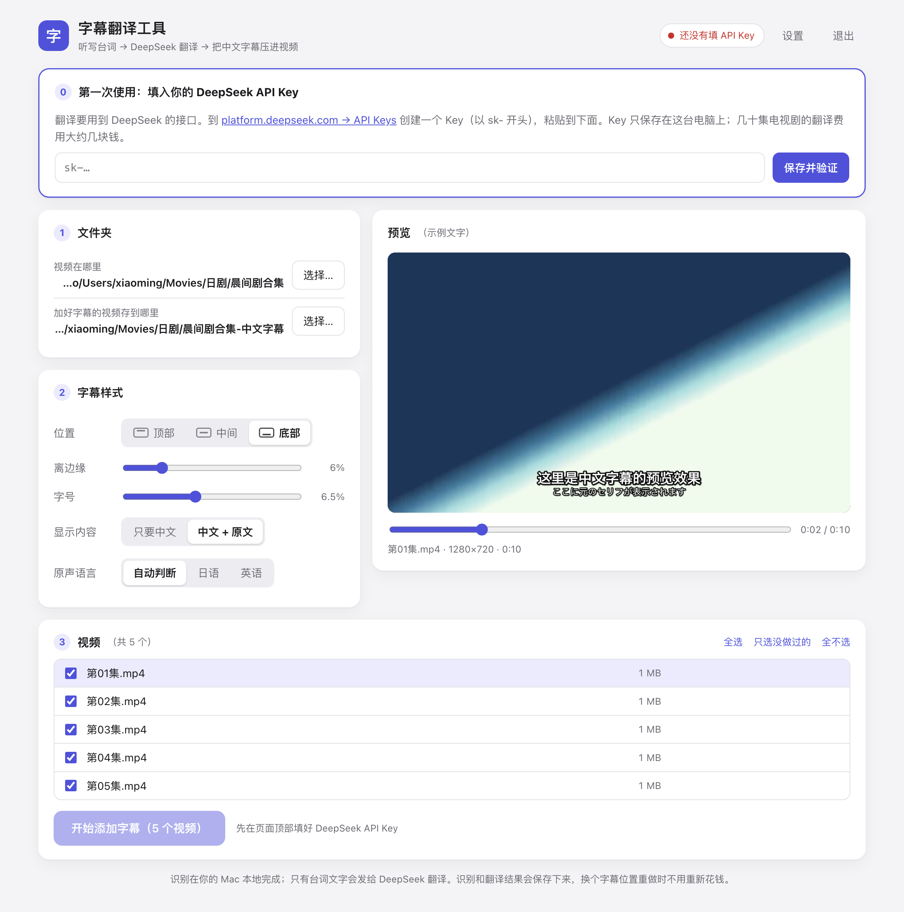

# 字幕翻訳ツール · Video Subtitle Translator · 字幕翻译工具

[简体中文](README.md) | [English](README.en.md) | **日本語**

外国語（日本語・英語など）の動画に、**中国語字幕を自動で付ける** Mac 用の小さなツールです。
ダブルクリックで起動し、ブラウザで数回クリックするだけ。**プログラミングの知識は不要です。**

> **ご注意：** 画面の表示は中国語で、翻訳先は**簡体字中国語のみ**です。
> 中国語が読めなくても使えるように、このページに[画面の用語対訳表](#画面の用語対訳表)を用意しています。



このツールがやってくれること：

1. **書き起こし** —— Whisper の音声認識でセリフを時間情報付きの文字にします。お使いの Mac の中で動くので無料、動画がどこかにアップロードされることはありません。（動画にテキスト字幕が入っている場合はそれを使います。その方が速くて正確です。）
2. **翻訳** —— まず DeepSeek が 1 話全体を読み（あらすじ作成・人名リスト整理・聞き間違いの洗い出し）、そのあと少しずつ簡体字中国語に翻訳します。
3. **焼き込み** —— 選んだ位置と文字サイズで字幕を映像に焼き込み、どのプレーヤーでも再生できる MP4 を出力します。

**目次**

- [はじめる前に](#はじめる前に)
- [インストール](#インストール)
- [DeepSeek API キーの取得](#deepseek-api-キーの取得)
- [はじめて使うとき](#はじめて使うとき)
- [画面の用語対訳表](#画面の用語対訳表)
- [使い方のコツ](#使い方のコツ)
- [速度と費用](#速度と費用)
- [困ったときは](#困ったときは)
- [プライバシーと API キーの安全性](#プライバシーと-api-キーの安全性)
- [アップデートとアンインストール](#アップデートとアンインストール)
- [ファイル構成と詳細設定](#ファイル構成と詳細設定)
- [開発者向け](#開発者向け)
- [謝辞とライセンス](#謝辞とライセンス)

---

## はじめる前に

次のものが揃っているか確認してください。

| 必要なもの | 説明 |
| --- | --- |
| **Apple シリコン搭載の Mac** | M1 / M2 / M3 / M4 … どれでも OK。画面左上のアップルメニュー →「この Mac について」を開き、「チップ」欄に **Apple M…** と書かれていれば大丈夫です。<br>Intel 搭載の Mac と Windows パソコンでは**使えません**。 |
| **macOS 14 以降** | 同じく「この Mac について」で確認できます。 |
| **約 5 GB の空き容量** | 実行環境 1 GB + 音声認識モデル 1.6 GB、それに出力する動画の分。 |
| **インターネット接続** | インストール時のダウンロードと、翻訳時の DeepSeek への接続に必要です。 |
| **DeepSeek API キー** | 翻訳に使います。従量課金でとても安価です（テレビドラマ数十話で合計数元、日本円で 100 円前後）。取得方法は[下記](#deepseek-api-キーの取得)を参照。ツールを入れたあとで取得しても構いません。 |

---

## インストール

全部で 3 ステップ。コマンドを 1 行コピー＆ペーストするだけです。**管理者パスワードは不要**で、すべて 1 つのフォルダの中に入り、Mac のほかのソフトには一切手を加えません。

### ステップ 1：「ターミナル」を開く

キーボードの `⌘ スペース` を押し、`ターミナル`（または `Terminal`）と入力して Return キーを押します。文字を入力できるウインドウが開きます。

### ステップ 2：次の 1 行を貼り付けて Return キーを押す

```bash
cd ~ && curl -fL https://github.com/bellingxu/video-subtitle-translator/archive/refs/heads/main.tar.gz | tar xz && bash video-subtitle-translator-main/install.sh
```

自動的に次のことが行われます。

- ツール本体をホームフォルダにダウンロード（フォルダ名は `video-subtitle-translator-main`）
- 実行環境のインストール（約 1 GB。通信速度によりますが、ふつう 5〜10 分）

**`✔ 安装完成！(Installation complete!)`** と表示されたら完了です。Finder が開き、起動用ファイルが選択された状態になります。

> 途中で通信が切れたり失敗したりしても大丈夫です。同じ 1 行をもう一度貼り付けて実行してください。

### ステップ 3：`字幕翻译工具.command` をダブルクリック

ターミナルのウインドウが開き（これがツールの「本体」です。**使っている間は閉じないでください**）、ブラウザに操作画面が自動で表示されます。

次回からも、このファイルをダブルクリックして起動します。右クリック →「エイリアスを作成」でできたエイリアスをデスクトップに置いておくと便利です。

<details>
<summary><b>ほかのインストール方法</b>（ZIP ダウンロード、git）</summary>

**ZIP でダウンロード：** GitHub のページで緑色の `Code` ボタン → `Download ZIP` をクリックし、展開したフォルダの中の `字幕翻译工具.command` をダブルクリックします。初回起動時に実行環境が自動でインストールされます。
この方法では、初回に macOS が「開発元を検証できません」と表示して起動を止めます。対処法は[困ったときは](#困ったときは)の 1 番をご覧ください。

**git を使う（あとで更新しやすい）：**

```bash
git clone https://github.com/bellingxu/video-subtitle-translator.git
```

```bash
bash video-subtitle-translator/install.sh
```

</details>

---

## DeepSeek API キーの取得

「API キー」は、あなたのアカウントの**合鍵**のようなものです。ツールはこれを使って DeepSeek に翻訳を依頼し、料金はあなたの DeepSeek アカウントの残高から引かれます。

1. <https://platform.deepseek.com> を開き、登録してログインします。
2. 左側のメニューの **Top up**（チャージ）で少額をチャージします（数ドルでかなり長く使えます）。残高がないと翻訳に失敗します。
3. 左側のメニューの **API keys** を開き、**Create new API key** をクリックします。名前は何でも構いません。
4. `sk-` で始まる文字列が表示されます —— これが API キーです。**すぐにコピーしてください。** 表示されるのはこの 1 回だけです。
5. ツールの画面に戻って貼り付け、**保存并验证**（保存して確認）をクリックします。

> ⚠️ **API キーはお金と同じです。他人に送ったり、ネットに載せたり（スクリーンショットも含む）しないでください。**
> 万一漏れてしまったら、手順 3 のページでそのキーを削除し、新しいキーを作り直してください。

（DeepSeek のサイトのボタン名は、今後少し変わることがあります。）

---

## はじめて使うとき

1. **`字幕翻译工具.command` をダブルクリック**します。ブラウザに操作画面が開きます。
2. **API キーを入力**します。ページ上部の「第一次使用」（はじめて使うとき）という枠にキーを貼り付け、「保存并验证」をクリックします。成功すると右上に「DeepSeek 已连接」（接続済み）と表示されます。
3. **フォルダを選びます**（1 番の欄「文件夹」）。
   - 「视频在哪里」—— 動画が入っているフォルダ
   - 「加好字幕的视频存到哪里」—— 字幕付き動画の保存先。上とは別のフォルダを選んでください（同じフォルダは不可）。選択画面の「新建文件夹」で新しいフォルダも作れます。
   - macOS が「“ターミナル”からフォルダへのアクセスを許可しますか」と尋ねてきたら、**許可**を選びます。
4. **字幕の見た目を調整します**（2 番の欄「字幕样式」）。位置、端からの距離、文字サイズ、中国語のみ／中国語＋原文、元の音声の言語。右側のプレビューにすぐ反映されます。プレビュー下のスライダーを動かすと別の場面で確認できます。
5. **処理したい動画にチェックを入れ**（3 番の欄「视频」）、**开始添加字幕**（字幕の追加を開始）をクリックします。
   - **初回のみ**、音声認識モデル（約 1.6 GB）のダウンロードが入ります。しばらくお待ちください。
   - 処理中は Mac がスリープしません。すべて終わると通知が届きます。
6. **完成した動画を見る：** 保存先フォルダに、元の動画と同じ名前の字幕付き MP4 ができています。
7. **終わったら：** 画面右上の「退出」（終了）をクリックするか、ターミナルのウインドウを閉じます。

---

## 画面の用語対訳表

| 画面の表示 | 意味 |
| --- | --- |
| 设置 | 設定 |
| 退出 | 終了 |
| 保存并验证 | 保存して確認（API キー） |
| 文件夹 | フォルダ |
| 视频在哪里 | 動画のある場所 |
| 加好字幕的视频存到哪里 | 字幕付き動画の保存先 |
| 选择… / 选择这个文件夹 | 選択… / このフォルダを選択 |
| 新建文件夹 | 新規フォルダ |
| 字幕样式 | 字幕のスタイル |
| 位置：顶部 / 中间 / 底部 | 位置：上 / 中央 / 下 |
| 离边缘 | 端からの距離 |
| 字号 | 文字サイズ |
| 显示内容：只要中文 / 中文 + 原文 | 表示内容：中国語のみ / 中国語＋原文 |
| 原声语言：自动判断 / 日语 / 英语 | 元の音声の言語：自動判定 / 日本語 / 英語 |
| 预览 | プレビュー |
| 视频 | 動画 |
| 全选 / 只选没做过的 / 全不选 | すべて選択 / 未処理のみ選択 / 選択解除 |
| 开始添加字幕 | 字幕の追加を開始 |
| 取消 | キャンセル |
| 剧情提示 | 作品メモ（タイトル、登場人物の名前など） |
| 压制方式：省电安静 / 文件更小 | エンコード方式：省電力・静音 / ファイルサイズ優先 |
| 翻译模型 | 翻訳モデル |
| 完成 / 关闭 / 确定 | 完了 / 閉じる / OK |

---

## 使い方のコツ

- **日本のテレビ番組は、画面の下の方にもともとテロップが入っていることがよくあります。** 中国語字幕を下に置くと重なってしまうので、位置を「顶部」（上）にするか、「离边缘」（端からの距離）を大きくしてください。
- **字幕の位置を変えても追加料金はかかりません。** 書き起こしと翻訳の結果は、ツールのフォルダ内の `data/cache/` に保存されています。処理済みの動画にもう一度チェックを入れて実行すると、焼き込みだけがやり直されます（1 話あたり数十秒）。
- **途中でキャンセルしても、そのまま閉じても大丈夫です。** 終わった分は残り、次回はその続きから再開します。
- **「设置 → 剧情提示」（作品メモ）：** 作品名や主な登場人物の名前・性別・関係を書いておくと（日本語のままで構いません）、翻訳の精度がぐっと上がります（たとえばヒロインが「彼」と訳されなくなります）。メモは動画フォルダごとに保存されるので、作品ごとに別の内容を書けます。
- **1 作品 1 フォルダで、順番に処理する：** 同じフォルダの動画は同じシリーズとして扱われます。前の話で決まった人名の訳し方を覚えていて、後の話でも同じ訳を使います。
- **「中文 + 原文」モード**では、中国語の下に原文が小さめに表示されます。語学学習に便利です。
- **「设置 → 压制方式」（エンコード方式）：**
  - 「省电安静」（初期設定）—— Mac 内蔵のハードウェアエンコーダを使います。CPU をほとんど使わず、熱くならず、ファンも静か。ファイルはやや大きめ（15 分の SD 動画で約 225 MB）。
  - 「文件更小」—— ソフトウェアエンコード。ファイルは最小（約 160 MB）ですが、CPU がフル稼働しファンが回ります。
- **「设置 → 翻译模型」（翻訳モデル）：** 初期設定の flash は速くて安く、ふだん使いには十分です。pro は少し高くなりますが、より丁寧に訳します。
- **動画と同じ名前の `.srt` 字幕ファイルが隣にある場合や、動画にテキスト字幕が入っている場合は、** 音声認識をせずにその字幕を翻訳します。その方が正確で速いです（設定でオフにできます）。
- **字幕ファイル単体：** 保存先フォルダの中の `字幕文件/` に、各話の `.srt` 字幕（中国語／原文／二か国語の 3 種類）が入っています。復習用や、ほかのプレーヤー用にどうぞ。
- **字幕にはときどき間違いがあります。** セリフは機械が聞き取っているため、聞き間違えた箇所（特に、はっきりしない短いセリフや背景の雑談）は翻訳も間違います。これは正常な動作です。

---

## 速度と費用

M1 Pro の MacBook Pro で、15 分の日本語ドラマ 1 話を処理した実測値：

| 工程 | 時間 | お金はかかる？ |
| --- | --- | --- |
| 書き起こし（音声認識） | 約 75 秒 | かかりません（Mac の中で実行） |
| 翻訳 | 約 12 秒 | 少しだけ。数十話で合計数元ほど |
| 焼き込み | 約 35 秒 | かかりません |

複数の話を続けて処理するときは 3 つの工程が同時に進み、平均すると 1 話あたり 1 分半ほどです。

---

## 困ったときは

**1. 起動用ファイルをダブルクリックすると「開けません」「開発元を検証できません」と表示される**

ZIP でダウンロードした場合にだけ起こります（macOS はブラウザでダウンロードしたプログラムに慎重です）。次のどちらかで解決できます。

- 「システム設定 → プライバシーとセキュリティ」を開いて下にスクロールし、`字幕翻译工具.command` についての表示の横にある **このまま開く** をクリックする
- [インストール](#インストール)にある 1 行コマンドの方法で入れ直す（この表示は出ません）

**2. フォルダを選ぶときに「没有权限查看这个文件夹」（このフォルダを見る権限がありません）と表示される**

「システム設定 → プライバシーとセキュリティ → ファイルとフォルダ」を開き、「ターミナル」の項目で該当するフォルダ（書類、ダウンロード、デスクトップなど）をオンにしてください。

**3. 初回の処理が「下载语音识别模型」（音声認識モデルをダウンロード中）のまま進まない**

モデルは 1.6 GB あるので、回線が遅いと時間がかかります。これは正常です。
**中国本土**では、モデルの配布元である Hugging Face に接続できないことがあります。その場合はミラーサイト経由で起動してください（ターミナルで実行）。

```bash
HF_ENDPOINT=https://hf-mirror.com ~/video-subtitle-translator-main/字幕翻译工具.command
```

モデルのダウンロードが済めば、次回からはふつうにダブルクリックで起動できます。（`hf-mirror.com` は有志が運営するミラーで、本プロジェクトとは無関係です。）

**4. インストール時のダウンロードがとても遅い、または何度も失敗する**

まず同じインストール用の 1 行をもう一度実行してください（自動で再試行されます）。中国本土では清華大学のミラーも使えます。

```bash
cd ~/video-subtitle-translator-main && CONDA_CHANNEL=https://mirrors.tuna.tsinghua.edu.cn/anaconda/cloud/conda-forge PIP_INDEX_URL=https://pypi.tuna.tsinghua.edu.cn/simple bash install.sh
```

**5. 「API Key 无效」（API キーが無効）と表示される**

コピーのときに数文字抜けたか、空白が混ざったことがほとんどです。DeepSeek の API keys ページで新しいキーを作り、もう一度貼り付けてください（「设置」でキーを入れ替えられます）。

**6. 「余额不足」（残高不足）と表示される**

<https://platform.deepseek.com> でチャージしてから、もう一度「开始添加字幕」をクリックしてください。終わった分はやり直されません。

**7. 人名の訳し方がばらばら、または性別を間違える**

「设置 → 剧情提示」に登場人物の名前・性別・関係を書き、その動画にもう一度チェックを入れて処理してください（翻訳し直されます）。

**8. 中国語以外の言語に翻訳できますか？**

今のところ**簡体字中国語のみ**です。元の音声の言語は、日本語・英語以外も指定できます。[詳細設定](#ファイル構成と詳細設定)をご覧ください。

**9. 対応している動画形式は？**

一般的な形式はほぼすべて使えます：`mp4` `mkv` `avi` `mov` `m4v` `wmv` `flv` `webm` `ts` `m2ts` `mts` `mpg` `mpeg` `rmvb` `rm` `3gp` `vob` `ogv` `asf` `divx` `f4v`。出力は常に MP4 です。

**10. ターミナルのウインドウは閉じてもいいですか？**

使っている間は閉じないでください。そのウインドウがツール本体なので、閉じるとツールも止まります。使い終わってから閉じてください（または画面の「退出」をクリック）。

**11. ブラウザのタブをうっかり閉じてしまった**

`字幕翻译工具.command` をもう一度ダブルクリックしてください。操作画面がまた開きます。実行中の処理には影響しません。

ほかに困ったことがあれば、GitHub の [Issues](https://github.com/bellingxu/video-subtitle-translator/issues) でお知らせください。**Issue やスクリーンショットに API キーを含めないようご注意ください。**

---

## プライバシーと API キーの安全性

- **動画と音声が Mac の外に出ることはありません。** 音声認識はすべてお使いの Mac の中で行われます。
- **DeepSeek に送られるのは文字だけです：** セリフ、動画のファイル名、あなたが書いた作品メモ。
- **API キーはあなたの Mac の中にだけ保存されます。** 保存場所はツールのフォルダ内の `data/secrets.json` で、本人だけが読める設定になっています。送信先は DeepSeek の公式 API のみで、本人確認のために使われます。
- **操作画面はその Mac からしか開けません**（アドレスは `127.0.0.1`）。同じ Wi-Fi にいるほかの人は接続できません。
- **このプロジェクトを改造して自分の GitHub に上げる場合：** `data/` フォルダ（キー・設定・キャッシュ）は `.gitignore` に登録済みなので、git でコミットしても含まれません。ただし、**GitHub のウェブ画面でフォルダごとドラッグ＆ドロップしてアップロードするのは避けてください。** ウェブからのアップロードには `.gitignore` が効きません。

---

## アップデートとアンインストール

**アップデート：** [インストール](#インストール)のステップ 2 の 1 行をもう一度実行してください。設定、API キー、翻訳済みのデータはそのまま残ります。

**アンインストール：** ホームフォルダの `video-subtitle-translator-main` をフォルダごと削除するだけです。
音声認識モデルは別の場所にあります。あわせて削除したい場合は、Finder で `⇧⌘G` を押して `~/.cache/huggingface/hub` と入力し、その中の `models--mlx-community--whisper-large-v3-turbo` を削除してください。

---

## ファイル構成と詳細設定

| 場所 | 内容 |
| --- | --- |
| `字幕翻译工具.command` | ダブルクリックで起動 |
| `install.sh` | 実行環境のインストール用スクリプト（起動用ファイルが自動で呼び出します） |
| `subtitle_tool/` | ツールのコード（`web/index.html` が操作画面） |
| `requirements.txt` | 音声認識に使うライブラリの一覧 |
| `runtime/` | インストール後に作られる実行環境（Python 3.12 + ffmpeg + 音声認識ライブラリ、約 1 GB） |
| `data/settings.json` | 使用後に作られる：画面で選んだ各種設定 |
| `data/secrets.json` | 使用後に作られる：DeepSeek API キー（本人のみ読み取り可） |
| `data/cache/` | 使用後に作られる：動画ごとの書き起こしと翻訳の結果。いつ削除しても構いません（削除した分は、次に処理するとき書き起こしと翻訳をやり直します） |

### 画面にはない `data/settings.json` の項目

`data/settings.json` を「テキストエディット」で開いて変更できます（先にツールを終了してください）。

- `source_lang`：元の音声の言語。画面では 自動 / 日本語 / 英語 だけですが、Whisper が対応しているほかの言語コードも指定できます。例：韓国語 `ko`、フランス語 `fr`、ドイツ語 `de`、スペイン語 `es`。
- `asr_model`：音声認識モデル。初期設定は `mlx-community/whisper-large-v3-turbo`（高速）。精度を上げたい場合は `mlx-community/whisper-large-v3-mlx`（約 3 GB、初回使用時に自動ダウンロード、速度は 3 分の 1 程度）に変更できます。
- `api_base`：翻訳 API のアドレス。初期設定は DeepSeek 公式の `https://api.deepseek.com`。

---

## 開発者向け

音声認識関連のライブラリを除けば、ツール本体は Python の標準ライブラリだけで書かれており、フロントエンドのビルド工程もありません。

```
subtitle_tool/
├── __main__.py     起動エントリ：python -m subtitle_tool [--port 8791] [--no-browser]
├── server.py       ローカル HTTP サーバ（127.0.0.1 のみ）。操作画面用の API
├── web/index.html  操作画面全体（1 ファイル、素の HTML / CSS / JS）
├── jobs.py         バッチ処理：書き起こし・翻訳・エンコードの 3 本を並行実行
├── pipeline.py     動画 1 本分の 3 工程とキャッシュ
├── asr_worker.py   音声認識のサブプロセス（mlx-whisper）
├── translate.py    DeepSeek クライアント（OpenAI 互換 API）
├── subs.py         字幕の整形・分割、ASS / SRT の生成
├── media.py        ffprobe / ffmpeg：情報取得、プレビュー画像、焼き込み
├── config.py       パス、設定、シークレットの読み書き
└── common.py       共通のエラー型とキャンセル処理
```

ソースから実行：

```bash
./runtime/bin/python -m subtitle_tool --no-browser --port 8791
```

環境変数：

| 変数 | 役割 |
| --- | --- |
| `DEEPSEEK_API_KEY` | 画面でキーを保存していないときに使われるキー |
| `SUBTITLE_TOOL_DATA` | `data/` の場所を変更 |
| `HF_ENDPOINT` | Hugging Face のミラー（音声認識モデルのダウンロード用） |

`install.sh` を使わず、手動で環境を作ることもできます（conda または mamba が必要）。

```bash
conda create -y -p ./runtime -c conda-forge --override-channels python=3.12 pip ffmpeg
```

```bash
./runtime/bin/python -m pip install --no-deps -r requirements.txt
```

> conda-forge の ffmpeg を使う理由：字幕の焼き込みには libass 付きの ffmpeg が必要です。conda-forge 版には最初から入っており、すべて `runtime/` の中に収まるのでシステムを汚しません。

**コミットする前に、** `data/` の中身が含まれていないことを確認してください（`git status` に出てこないはずです）。Issue や Pull Request を歓迎します。コード中のコメントと画面の文言は中国語です。

---

## 謝辞とライセンス

このツールは、次のプロジェクトのおかげで成り立っています。

- [Whisper](https://github.com/openai/whisper)（OpenAI）と [mlx-whisper](https://github.com/ml-explore/mlx-examples/tree/main/whisper)（Apple MLX）—— 音声認識
- [FFmpeg](https://ffmpeg.org) と [libass](https://github.com/libass/libass) —— 動画処理と字幕の描画
- [DeepSeek](https://www.deepseek.com) —— 翻訳
- [micromamba](https://mamba.readthedocs.io) と [conda-forge](https://conda-forge.org) —— 実行環境のインストール

このリポジトリのコードは [MIT ライセンス](LICENSE)で公開しています。インストール時にダウンロードされる ffmpeg などの第三者ソフトウェアには、それぞれのライセンスが適用されます。

利用する権利のある動画だけを処理し、お住まいの地域の著作権法を守ってご利用ください。
