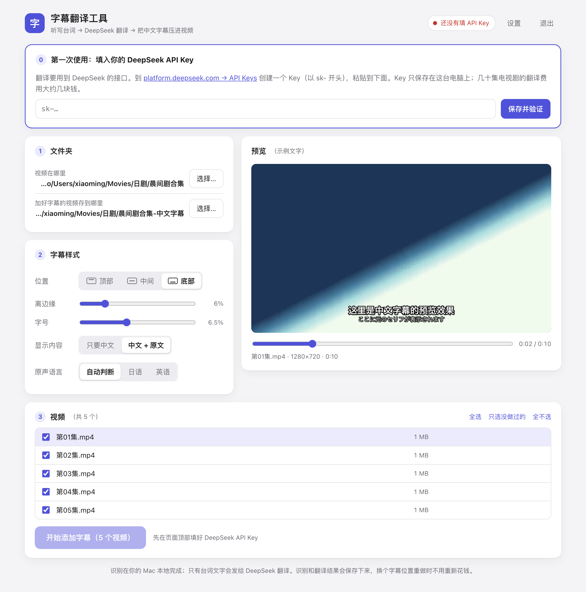

# 字幕翻译工具 · Video Subtitle Translator

**简体中文** | [English](README.en.md) | [日本語](README.ja.md)

给外语视频（日语、英语……）**自动配上中文字幕**的 Mac 小工具。
双击启动，在浏览器里点几下就行，**不需要懂编程**。



它会替你做三件事：

1. **听写** —— 用 Whisper 语音识别把台词听写成带时间轴的文字。在你自己的 Mac 上运行，免费，视频不会上传到任何地方。（视频自带文字字幕时直接用字幕，更快更准。）
2. **翻译** —— 先让 DeepSeek 通读全集（写出剧情概要、整理人名表、挑出听错的词），再分批翻译成简体中文。
3. **压制** —— 按你选的位置和字号把字幕压进画面，输出一个任何播放器都能直接看的 MP4。

**目录**

- [开始之前](#开始之前)
- [安装](#安装)
- [申请 DeepSeek API Key](#申请-deepseek-api-key)
- [第一次使用](#第一次使用)
- [使用技巧](#使用技巧)
- [速度和费用](#速度和费用)
- [常见问题](#常见问题)
- [隐私和 API Key 的安全](#隐私和-api-key-的安全)
- [更新和卸载](#更新和卸载)
- [文件说明和高级设置](#文件说明和高级设置)
- [给开发者](#给开发者)
- [致谢和许可证](#致谢和许可证)

---

## 开始之前

先确认下面几样都具备：

| 需要什么 | 说明 |
| --- | --- |
| **Apple 芯片的 Mac** | M1 / M2 / M3 / M4 …… 都可以。点屏幕左上角的苹果图标 → “关于本机”，“芯片”一栏写着 **Apple M…** 就是。<br>Intel 芯片的 Mac 和 Windows 电脑**用不了**。 |
| **macOS 14 或更新** | 同样在“关于本机”里能看到系统版本。 |
| **约 5 GB 硬盘空间** | 运行环境 1 GB + 语音识别模型 1.6 GB，再加上你要输出的视频。 |
| **能上网** | 安装时要下载；翻译时要连 DeepSeek。 |
| **DeepSeek API Key** | 翻译用，按用量付费，很便宜（几十集电视剧大约几块钱）。申请方法见[下面](#申请-deepseek-api-key)，可以装好工具以后再申请。 |

---

## 安装

一共三步，全程只需要复制粘贴一行命令。**不需要管理员密码**，所有东西都装在一个文件夹里，不会改动电脑上的其它软件。

### 第 1 步：打开“终端”

按键盘上的 `⌘ 空格`，输入 `终端`（或 `Terminal`），按回车。会出现一个可以打字的窗口。

### 第 2 步：粘贴下面这一行，按回车

```bash
cd ~ && curl -fL https://github.com/bellingxu/video-subtitle-translator/archive/refs/heads/main.tar.gz | tar xz && bash video-subtitle-translator-main/install.sh
```

它会自动：

- 把工具下载到你的“个人文件夹”里，文件夹名字叫 `video-subtitle-translator-main`；
- 安装运行环境（约 1 GB，一般 5～10 分钟，取决于网速）。

等到出现 **`✔ 安装完成！`** 就好了。访达（Finder）会自动弹出来，并选中启动文件。

> 中途断网或失败了也没关系，把同一行命令再粘贴运行一次即可。

### 第 3 步：双击 `字幕翻译工具.command`

会出现一个终端窗口（这是工具的“后台”，**用的时候别关**），浏览器会自动打开操作界面。

以后每次要用，都是双击这个文件。想方便一点，可以对它点右键 →“制作替身”，把替身拖到桌面上。

<details>
<summary><b>其它安装方式</b>（下载 ZIP、用 git）</summary>

**下载 ZIP：** 在 GitHub 页面点绿色的 `Code` → `Download ZIP`，解压后双击里面的 `字幕翻译工具.command`，第一次启动时它会自动安装运行环境。
用这种方式，macOS 第一次会拦住它，提示“无法验证开发者”。解决办法见[常见问题](#常见问题)第 1 条。

**用 git（方便以后更新）：**

```bash
git clone https://github.com/bellingxu/video-subtitle-translator.git
```

```bash
bash video-subtitle-translator/install.sh
```

</details>

---

## 申请 DeepSeek API Key

“API Key”可以理解成一把**钥匙**：工具拿着它，才能请 DeepSeek 帮你翻译，费用记在你的 DeepSeek 账户上。

1. 打开 <https://platform.deepseek.com>，注册并登录。
2. 在左侧菜单找到 **充值**，先充一点钱（比如 10 元，够用很久）。账户里没有余额时翻译会失败。
3. 在左侧菜单找到 **API keys**，点 **创建 API key**，名字随便填。
4. 页面会显示一串以 `sk-` 开头的字符 —— 这就是你的 Key。**马上复制下来**，它只显示这一次。
5. 回到工具的界面，粘贴进去，点 **保存并验证**。

> ⚠️ **Key 等于钱，不要发给别人，也不要发到网上（包括截图）。**
> 万一泄露了，回到上面第 3 步的页面把它删掉，再创建一个新的就行。

（DeepSeek 网站的按钮名称可能会有小的变动，找意思相近的即可。）

---

## 第一次使用

1. **双击 `字幕翻译工具.command`**，浏览器会打开操作界面。
2. **填 API Key**：页面顶部有一块“第一次使用”的区域，把 Key 粘贴进去，点“保存并验证”。成功后右上角会显示“DeepSeek 已连接”。
3. **选文件夹**（第 1 栏）：
   - “视频在哪里” —— 选放着外语视频的文件夹；
   - “加好字幕的视频存到哪里” —— 另选一个文件夹（不能和上面是同一个）。可以在选择窗口里直接“新建文件夹”。
   - 如果 macOS 弹窗问“是否允许‘终端’访问某某文件夹”，点 **允许**。
4. **调字幕样式**（第 2 栏）：位置（顶部 / 中间 / 底部）、离边缘的距离、字号、只要中文还是“中文 + 原文”、原声语言。右边的预览会实时显示效果，拖动预览下面的滑块可以换一个画面。
5. **勾选要处理的视频**（第 3 栏），点 **开始添加字幕**。
   - **第一次**会先下载语音识别模型（约 1.6 GB，只需这一次），请耐心等一会儿。
   - 处理期间电脑不会自动睡眠，全部完成后会有系统通知。
6. **看成品**：输出文件夹里是加好字幕的 MP4，文件名和原视频一样。
7. **用完后**：点界面右上角的“退出”，或者直接关掉那个终端窗口。

---

## 使用技巧

- **日本电视节目的画面下方常有自带的日文说明字幕**，中文字幕放底部会和它叠在一起。可以把位置改成“顶部”，或把“离边缘”调大一些。
- **换字幕位置不用重新花钱**：识别和翻译的结果都保存在工具文件夹的 `data/cache/` 里。把已完成的视频重新勾上再处理，只会重新压制（每集几十秒）。
- **中途可以取消，也可以直接关掉**：已完成的部分都会保留，下次接着做。
- **“设置 → 剧情提示”**：写上剧名、主要人物的名字、性别和关系，翻译会准很多（比如不会把女主角写成“他”）。提示是按“视频文件夹”分别保存的，换一部剧可以另写一份。
- **一部剧放一个文件夹，按顺序处理**：同一个文件夹里的视频会被当作同一部剧，工具会记住前面几集定下来的人名译法，后面的集数沿用。
- **“中文 + 原文”模式**会在中文下面显示一行小一点的原文，适合边看边学外语。
- **“设置 → 压制方式”**：
  - “省电安静”（默认）—— 用 Mac 自带的硬件编码芯片，几乎不占 CPU，电脑不烫、风扇不吵；文件稍大（15 分钟的标清视频约 225 MB）。
  - “文件更小” —— 用软件编码，文件最小（约 160 MB），但 CPU 会跑满、风扇会响。
- **“设置 → 翻译模型”**：默认的 flash 又快又便宜，日常足够；pro 贵一些，翻译更讲究。
- **视频旁边有同名的 `.srt` 字幕文件、或视频里自带文字字幕时**，工具会直接翻译字幕而不做语音识别，比听写更准也更快（可在设置里关掉）。
- **单独的字幕文件**：输出文件夹里的 `字幕文件/` 里有每集的 `.srt` 字幕（中文 / 原文 / 双语三份），可以用来复习，或者给别的播放器用。
- **字幕偶尔会有错**：台词是机器听写的，听错的地方（尤其是含糊的短句、背景里的闲聊）翻译也会跟着错，属于正常现象。

---

## 速度和费用

在 M1 Pro 的 MacBook Pro 上实测，一集 15 分钟的日语电视剧：

| 工序 | 用时 | 花钱吗 |
| --- | --- | --- |
| 听写（语音识别） | 约 75 秒 | 不花钱，在本机运行 |
| 翻译 | 约 12 秒 | 花一点点，几十集大约几块钱 |
| 压制 | 约 35 秒 | 不花钱 |

多集连着做时三道工序同时进行，平均每集 1.5 分钟左右。

---

## 常见问题

**1. 双击启动文件，macOS 提示“无法打开”或“无法验证开发者”**

只有用“下载 ZIP”的方式才会遇到（macOS 对从浏览器下载的程序比较谨慎）。任选一种办法：

- 打开“系统设置 → 隐私与安全性”，往下翻，找到关于 `字幕翻译工具.command` 的提示，点 **仍要打开**；
- 或者改用上面[安装](#安装)里的命令行方式，就不会有这个提示。

**2. 选文件夹时提示“没有权限查看这个文件夹”**

打开“系统设置 → 隐私与安全性 → 文件和文件夹”，找到“终端”，把对应的文件夹（文稿、下载、桌面……）打开。

**3. 第一次处理时一直停在“下载语音识别模型”**

模型有 1.6 GB，网速慢时要等比较久，属于正常。
如果你在**中国大陆**，模型所在的 Hugging Face 网站可能连不上，可以改用镜像站来启动（在终端里运行）：

```bash
HF_ENDPOINT=https://hf-mirror.com ~/video-subtitle-translator-main/字幕翻译工具.command
```

模型下载完成之后，以后正常双击启动即可。（`hf-mirror.com` 是第三方维护的公益镜像，与本项目无关。）

**4. 安装时下载特别慢，或者总是失败**

先把同一行安装命令再运行一次（会自动重试）。在中国大陆可以改用清华大学的镜像：

```bash
cd ~/video-subtitle-translator-main && CONDA_CHANNEL=https://mirrors.tuna.tsinghua.edu.cn/anaconda/cloud/conda-forge PIP_INDEX_URL=https://pypi.tuna.tsinghua.edu.cn/simple bash install.sh
```

**5. 提示“API Key 无效”**

多半是复制时少了几个字符，或者多了空格。到 DeepSeek 的 API keys 页面重新创建一个，再粘贴一次（“设置”里可以更换 Key）。

**6. 提示“余额不足”**

到 <https://platform.deepseek.com> 充值后，回来重新点“开始添加字幕”即可，已经做完的部分不会重做。

**7. 人名一会儿一个译法，或者把男女搞错了**

在“设置 → 剧情提示”里写上人物的名字、性别和关系，然后把视频重新勾上处理一次（会重新翻译）。

**8. 能翻译成中文以外的语言吗？**

目前只支持翻译成**简体中文**。原声语言除了界面上的日语、英语，也可以手动指定别的语言，见[高级设置](#文件说明和高级设置)。

**9. 支持哪些视频格式？**

常见的都可以：`mp4` `mkv` `avi` `mov` `m4v` `wmv` `flv` `webm` `ts` `m2ts` `mts` `mpg` `mpeg` `rmvb` `rm` `3gp` `vob` `ogv` `asf` `divx` `f4v`。输出统一是 MP4。

**10. 终端窗口可以关吗？**

用的时候不能关 —— 它就是工具本身，关掉它工具就停了。用完后再关（或点界面上的“退出”）。

**11. 不小心把浏览器页面关了**

再双击一次 `字幕翻译工具.command`，它会重新打开界面，正在进行的任务不受影响。

还有别的问题？欢迎到 GitHub 的 [Issues](https://github.com/bellingxu/video-subtitle-translator/issues) 页面提问。**提问或截图时请不要带上你的 API Key。**

---

## 隐私和 API Key 的安全

- **视频和声音不会离开你的电脑。** 语音识别完全在本机运行。
- **发给 DeepSeek 的只有文字**：台词、视频的文件名、你写的剧情提示。
- **API Key 只保存在你自己的电脑上**：工具文件夹里的 `data/secrets.json`，设成了只有你本人能读。它只会被发送到 DeepSeek 的官方接口，用来证明“是你在用”。
- **操作界面只有本机能打开**（地址是 `127.0.0.1`），同一个 Wi-Fi 下的其他人连不进来。
- **如果你想修改这个项目并上传到自己的 GitHub**：`data/` 文件夹（里面有你的 Key、设置和缓存）已经写进了 `.gitignore`，用 git 提交时不会被带上。但请注意，**不要用 GitHub 网页的“拖拽上传”把整个文件夹传上去** —— 网页上传不受 `.gitignore` 保护。

---

## 更新和卸载

**更新：** 把[安装](#安装)第 2 步的那行命令再运行一次。你的设置、API Key 和已经翻译好的内容都会保留。

**卸载：** 把个人文件夹里的 `video-subtitle-translator-main` 整个删掉即可。
语音识别模型放在另一个地方，想一并清理的话，在访达里按 `⇧⌘G`，输入 `~/.cache/huggingface/hub`，删掉里面的 `models--mlx-community--whisper-large-v3-turbo`。

---

## 文件说明和高级设置

| 位置 | 内容 |
| --- | --- |
| `字幕翻译工具.command` | 双击启动 |
| `install.sh` | 安装运行环境的脚本（启动文件会自动调用它） |
| `subtitle_tool/` | 工具的代码（`web/index.html` 是界面） |
| `requirements.txt` | 语音识别用到的库的清单 |
| `runtime/` | 安装后才有：自带的运行环境（Python 3.12 + ffmpeg + 语音识别库，约 1 GB） |
| `data/settings.json` | 使用后才有：界面上的各种选项 |
| `data/secrets.json` | 使用后才有：你的 DeepSeek API Key（仅本人可读） |
| `data/cache/` | 使用后才有：每个视频的识别和翻译结果。可以随时删除，删了以后再处理就要重新识别、翻译 |

### `data/settings.json` 里没有放到界面上的选项

用“文本编辑”打开 `data/settings.json` 可以修改（先退出工具再改）：

- `source_lang`：原声语言。界面上只有 自动 / 日语 / 英语，也可以手动填 Whisper 支持的其它语言代码，例如韩语 `ko`、法语 `fr`、德语 `de`、西班牙语 `es`。
- `asr_model`：语音识别模型。默认 `mlx-community/whisper-large-v3-turbo`（快）；想要更高的准确度可以换成 `mlx-community/whisper-large-v3-mlx`（约 3 GB，第一次使用时自动下载，速度慢 3 倍左右）。
- `api_base`：翻译接口的地址，默认是 DeepSeek 官方的 `https://api.deepseek.com`。

---

## 给开发者

除了语音识别相关的库，工具本身只用 Python 标准库，没有前端构建步骤。

```
subtitle_tool/
├── __main__.py     启动入口：python -m subtitle_tool [--port 8791] [--no-browser]
├── server.py       本地 HTTP 服务（只监听 127.0.0.1），给界面提供接口
├── web/index.html  整个界面（单个文件，原生 HTML / CSS / JS）
├── jobs.py         批量任务：识别、翻译、压制三条流水线并行
├── pipeline.py     单个视频的三道工序和缓存
├── asr_worker.py   语音识别子进程（mlx-whisper）
├── translate.py    调用 DeepSeek（OpenAI 兼容接口）
├── subs.py         字幕整理、断句，生成 ASS / SRT
├── media.py        ffprobe / ffmpeg：读取信息、截图预览、压制
├── config.py       路径、设置和密钥的读写
└── common.py       共用的错误类型和取消机制
```

从源码运行：

```bash
./runtime/bin/python -m subtitle_tool --no-browser --port 8791
```

可用的环境变量：

| 变量 | 作用 |
| --- | --- |
| `DEEPSEEK_API_KEY` | 没有在界面里保存 Key 时，用这个环境变量里的 Key |
| `SUBTITLE_TOOL_DATA` | 把 `data/` 换到别的位置 |
| `HF_ENDPOINT` | Hugging Face 镜像地址（下载语音识别模型用） |

不想用 `install.sh` 的话，也可以手动搭环境（需要已安装 conda 或 mamba）：

```bash
conda create -y -p ./runtime -c conda-forge --override-channels python=3.12 pip ffmpeg
```

```bash
./runtime/bin/python -m pip install --no-deps -r requirements.txt
```

> 为什么用 conda-forge 的 ffmpeg：压字幕需要 ffmpeg 带 libass，conda-forge 的版本自带，而且整个装在 `runtime/` 里，不动系统。

**提交代码前**请确认没有把 `data/` 里的东西带上（`git status` 里不应该出现它）。欢迎提 Issue 和 Pull Request。

---

## 致谢和许可证

这个工具站在这些项目的肩膀上：

- [Whisper](https://github.com/openai/whisper)（OpenAI）和 [mlx-whisper](https://github.com/ml-explore/mlx-examples/tree/main/whisper)（Apple MLX）—— 语音识别
- [FFmpeg](https://ffmpeg.org) 和 [libass](https://github.com/libass/libass) —— 视频处理和字幕渲染
- [DeepSeek](https://www.deepseek.com) —— 翻译
- [micromamba](https://mamba.readthedocs.io) 和 [conda-forge](https://conda-forge.org) —— 运行环境的安装

本项目的代码以 [MIT 许可证](LICENSE) 开源。安装时下载的 ffmpeg 等第三方软件遵循它们各自的许可证。

请只处理你有权使用的视频，并遵守所在地区的版权法规。
